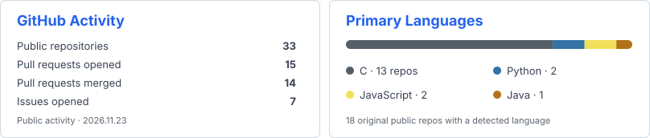

# Links

 

# Skills

### Frameworks

   

### Languages

    

### AI & Computer Vision

   

### Database & Systems

   

# Experiences

| 활동 | 내용 | 기간 |
| --- | --- | --- |
| SOLUX 31기 · 오두막 책방 *(PM)* | 9인 팀에서 독서방·메모 기능 기획, 프론트엔드와 백엔드 일정 조율 | 2026 2학기–진행 중 |
| HaiperPage 산학협력 | 상품 상세페이지의 HTML·이미지 텍스트 수집 및 검색 노출 진단 로직 개발 | 2026.09–진행 중 |
| 센서프로그래밍 3팀 | 라즈베리파이에서 카메라·센서 입력과 서보모터 제어 연동 | 2026 2학기 |
| SOLUX 31기 · 이음 *(Frontend)* | 인지 퀴즈·리포트 화면 개발, Playwright로 사용자 흐름 테스트 | 2026 1학기–여름 |
| 오손도손 · IPS 개발팀 *(Backend)* | FastAPI로 모임 생성, 초대, 참여자 상태 관리 기능 구현 | 2026.04–05 |
| 인공지능공학부 겨울 AI 스터디 | RAG 원 논문의 검색·생성 모델 구조 발표, GEPA 후속 분석 | 2026년 초 |

# Projects

| 프로젝트명 | 기간 | 핵심 기술 | 설명 |
| --- | --- | --- | --- |
| [스마트 분리수거기](https://github.com/sensor-recycle/campus-recycle) | 2026 · 진행 중 |   | 캔·플라스틱·종이 분류판 제어와 초음파 적재량 측정 |
| [오두막 책방](https://github.com/ezhye0n/31th_2_CtrlZ_odumak_back) | 2026 2학기 · 진행 중 |   | 독서방에서 진도와 메모를 나누고 서로의 관점을 읽는 서비스 |
| HaiperPage | 2026.09–진행 중 |   | 상품 상세페이지에서 검색 노출을 진단할 근거를 추출하는 도구 |
| 아이하루 | 2026 여름 |   | 교사의 관찰 기록을 근거로 보육 문서 초안을 작성하는 서비스 |
| [이음](https://github.com/sm-solux/31th_hello_lux_ieum_front) | 2026 1학기–여름 |   | 치매 환자·보호자·의료진을 위한 인지 퀴즈와 활동 리포트 |
| [SafePath AI](https://github.com/26-OSSP/2026_OSS_Project) | 2026.05–06 |   | 실내 사진의 장애물과 소방 설비를 탐지해 대피 위험을 비교 |
| [fAIrmeet](https://github.com/osondoson-team/fAIrmeet) | 2026.04–05 |   | 참여자별 출발지와 이동 수단을 반영한 약속 장소 추천 |
| [StudyTown](https://github.com/cocomong11/StudyTown) | 2026.03 |   | 공부 타이머와 미션을 캐릭터·마을에 연결한 학습 앱 |
| [GEPA 실험](https://github.com/cocomong11/Chaehyun-AI-Archive/blob/main/Self-evolving%20AI%20%20%ED%94%84%EB%A1%AC%ED%94%84%ED%8A%B8%20%EC%9E%90%EB%8F%99%EC%B5%9C%EC%A0%81%ED%99%94%28GEPA%29%EC%8B%9C%EC%8A%A4%ED%85%9C%20%EA%B5%AC%ED%98%84%20%EB%B0%8F%20%EB%B6%84%EC%84%9D.pdf) | 2026.03 |  | 프롬프트 자동 최적화 방식을 실험하고 결과를 시각화 |
| [Recipick](https://github.com/cocomong11/Recipick) | 2025 하반기 |   | 메뉴별 레시피 탐색과 최근 본 레시피·저장 목록 관리 |
| [SM-Data](https://github.com/cocomong11/2025_SM_Data) | 2025 |   | 학생의 부족 역량에 맞춰 비교과 프로그램을 추천 |
| [SMMarble](https://github.com/cocomong11/SMMarble) | 2025 |  | 학점과 에너지를 관리해 졸업하는 콘솔 보드게임 |

# Git Stats

# Algorithms

| 주제 | 구현 · 분석 |
| --- | --- |
| 추천 알고리즘 | [부족 역량에 가중치를 부여해 상위 K개 프로그램 추천](https://github.com/cocomong11/2025_SM_Data/blob/main/SourceCode/baseline_recommender.py) |
| 프롬프트 최적화 | [GEPA 논문 분석](https://github.com/cocomong11/Chaehyun-AI-Archive/blob/main/GEPA%EB%85%BC%EB%AC%B8%EB%B6%84%EC%84%9D-%EC%B1%84%ED%98%84.pdf) · [구현 및 실험 결과](https://github.com/cocomong11/Chaehyun-AI-Archive/blob/main/Self-evolving%20AI%20%20%ED%94%84%EB%A1%AC%ED%94%84%ED%8A%B8%20%EC%9E%90%EB%8F%99%EC%B5%9C%EC%A0%81%ED%99%94%28GEPA%29%EC%8B%9C%EC%8A%A4%ED%85%9C%20%EA%B5%AC%ED%98%84%20%EB%B0%8F%20%EB%B6%84%EC%84%9D.pdf) |
| 검색 증강 생성 | [RAG의 검색기·생성기 구조 분석](https://github.com/cocomong11/Chaehyun-AI-Archive/blob/main/RAG%20%EB%85%BC%EB%AC%B8%EB%B6%84%EC%84%9D-%EB%B0%95%EC%B1%84%ED%98%84.pdf) |
